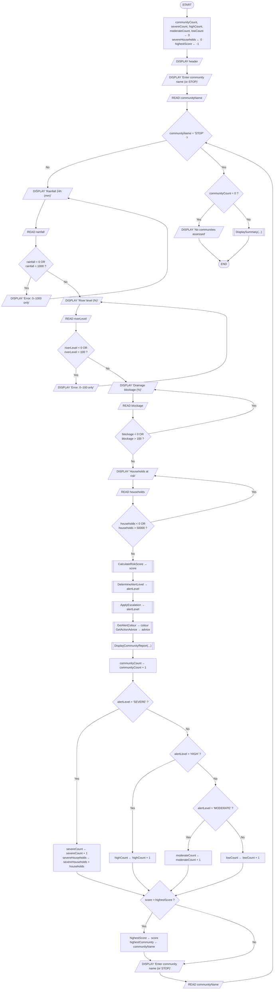
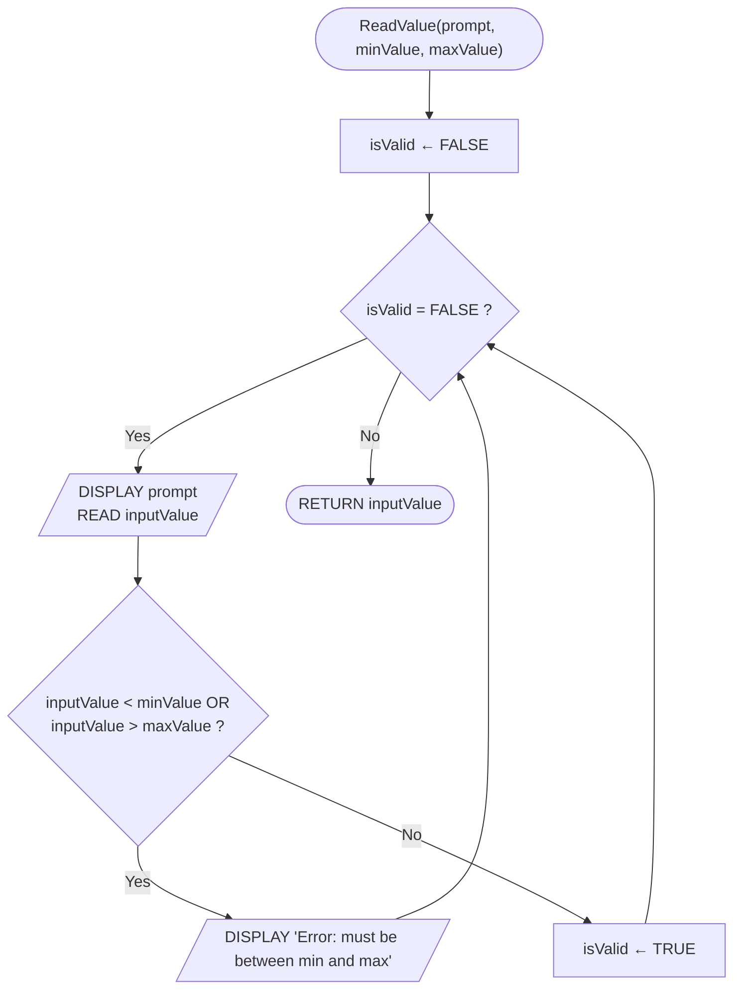
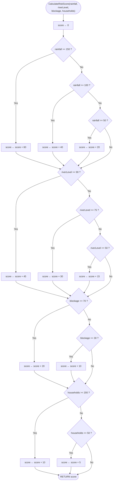
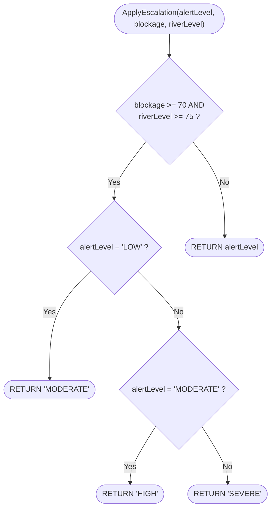

# PROG101 — FloodWatch SL Community Flood Risk Early Warning System

Project: FloodWatch SL — Community Flood Risk Early Warning System (FWSL)  
Student: James Foday Conteh Student ID: 905006554  
Course: PROG101 — Principles of Programming Logic and Design  

## Contents

1. [Overview](#overview)
2. [Rationale](#rationale)
3. [Risk model](#risk-model)
4. [Algorithm](#algorithm)
5. [Modules](#modules)
6. [Pseudocode](#pseudocode)
7. [Flowcharts](#flowcharts)
8. [Author](#author)

## Overview

FWSL is a classroom logic prototype for a community flood early warning workflow in Freetown, Sierra Leone. It reads four environmental indicators for each community (rainfall in the last 24 hours, river level as a percentage of bank-full, drainage blockage percentage and households at risk), validates them, calculates a weighted risk score, classifies it into one of four alert levels, applies a Boolean escalation rule, and repeats until the user enters STOP. It demonstrates sequence, selection, repetition, functions, Boolean logic and modular design. No source code is included, by design.

## Rationale

### Problem description

Freetown experiences severe seasonal flooding that causes loss of life, displacement of families, destruction of property and outbreaks of waterborne disease. The greatest difficulty is not the rainfall itself but the absence of timely, locally specific warning. Communities learn that a flood is coming when the water has already entered their homes.

This project designs the logical structure of FloodWatch SL, a community flood risk early warning system. It processes four measurable indicators through a weighted risk model to produce a risk score, a four-tier alert level and a specific recommended action, repeats the assessment for any number of communities, and produces a summary showing where response resources should go first.

### Background

Freetown sits on a narrow coastal peninsula beneath steep hills, so rainwater descends rapidly into densely built, low-lying settlements such as Kroo Bay, Susan's Bay, Lumley and Aberdeen. Deforestation on the slopes has reduced the land's capacity to absorb rainfall, and drainage channels are frequently blocked by solid waste. The result is flash flooding from relatively moderate rainfall.

The mudslide and flooding of 14 August 2017 killed more than one thousand people in the Regent and Sugar Loaf communities. Annual flooding displaces thousands of households, contaminates wells and pit latrines, and is regularly followed by cholera and typhoid outbreaks, as in the 2012 cholera epidemic.

Sierra Leone already has the institutions to act on warnings: the National Disaster Management Agency (NDMA), the Freetown City Council and the Sierra Leone Meteorological Agency (SLMet). What is missing is a structured, repeatable method for converting raw measurements into a consistent alert classification. A defined algorithm removes that inconsistency.

### Community impact

The direct beneficiaries are residents of flood-prone informal settlements, who gain warning time to move belongings, secure documents, evacuate to higher ground and protect vulnerable family members. Secondary beneficiaries include:

- Community health workers and clinics, who can pre-position oral rehydration salts and cholera treatment supplies before floodwater contaminates water sources.
- Local government and NDMA, who gain an objective, comparable basis for allocating limited response resources.
- Schools, which can be closed pre-emptively rather than reactively.
- Small traders and market vendors, whose stock losses represent their entire livelihood.

The broader impact is a shift from reactive disaster response to anticipatory action.

### Proposed solution

FWSL works in four stages:

1. **Validated data capture:** four indicators are read for a community, each constrained to a physically meaningful range, with invalid entries rejected and re-prompted.
2. **Weighted scoring:** each indicator contributes points depending on its band, giving a composite score from 0 to 135.
3. **Classification:** the score is mapped to LOW, MODERATE, HIGH or SEVERE, each with a colour and a prescribed action.
4. **Escalation:** if drainage blockage is 70% or more AND river level is 75% or more, the alert is raised one level regardless of the score, because blocked drainage causes flash flooding even when rainfall is moderate.

### Computational thinking

- **Decomposition:** the task "warn communities about floods" is split into nine modules, each small enough to check in isolation.
- **Pattern recognition:** three of the four indicators are scored by the same pattern: compare against descending thresholds and add a fixed number of points.
- **Abstraction:** only four indicators are modelled, chosen because they are measurable with simple equipment, available at community level and linked to flood impact. Everything else is deliberately ignored.
- **Algorithm design:** the abstraction is expressed as a step-by-step algorithm, pseudocode and flowcharts, so the same inputs always produce the same alert level.

### SDG alignment

- **SDG 11 — Sustainable Cities and Communities:** Target 11.5 reduces deaths and losses from water-related disasters. This is the primary alignment.
- **SDG 13 — Climate Action:** Target 13.1 strengthens resilience and adaptive capacity to climate-related hazards.
- **SDG 3 — Good Health and Well-being:** Target 3.9 reduces illness from water contamination, since flooding is the main trigger of cholera outbreaks in Freetown.

There is secondary alignment with SDG 9 (resilient infrastructure) and SDG 17 (partnerships).

### Why open source

- **Affordability:** councils and NDMA have tight budgets, and open source removes recurring licensing costs.
- **Sovereignty and transparency:** a model that decides whether a community evacuates must be publicly auditable.
- **Localisation:** alert messages can be translated into Krio, Mende, Temne and Limba without a vendor's permission.
- **Community contribution:** Sierra Leonean graduates can study, extend and maintain the system, and universities can use it for teaching.

### Digital Public Good

FWSL is designed to meet the Digital Public Goods criteria. It would be released under the MIT licence with its risk model, documentation and test data published. It uses open data (SLMet rainfall and river readings) and open standards, holds no personal data because it processes community-level aggregates only, and does no harm by using conservative escalation rules with human confirmation at the SEVERE level. Comparable precedents used in Sierra Leone are DHIS2, OpenStreetMap and KoboToolbox.

## Risk model

| Indicator | Band | Points |
|---|---|---|
| **Rainfall, last 24 h** (max 60) | 150 mm or more | 60 |
| | 100–149 mm | 40 |
| | 50–99 mm | 20 |
| | below 50 mm | 0 |
| **River level, % of bank-full** (max 45) | 90% or more | 45 |
| | 75–89% | 30 |
| | 50–74% | 15 |
| | below 50% | 0 |
| **Drainage blockage** (max 20) | 70% or more | 20 |
| | 30–69% | 10 |
| | below 30% | 0 |
| **Households at risk** (max 10) | 200 or more | 10 |
| | 50–199 | 5 |
| | below 50 | 0 |

Maximum composite score: **135**.

| Composite score | Alert level | Colour | Prescribed action |
|---|---|---|---|
| 90 or more | SEVERE | RED | Immediate evacuation advisory; broadcast via community radio and SMS; open evacuation centres; notify NDMA and City Council |
| 60–89 | HIGH | ORANGE | Prepare to evacuate; clear drainage; alert health workers; monitor hourly |
| 30–59 | MODERATE | YELLOW | Clear drains; move goods to higher ground; monitor twice daily |
| below 30 | LOW | GREEN | Routine monitoring; no immediate action |

**Escalation rule (Boolean AND):** if `blockage >= 70` AND `riverLevel >= 75`, raise the alert one step (LOW to MODERATE to HIGH to SEVERE; SEVERE stays SEVERE). Neither condition alone triggers escalation, which is why the rule uses AND rather than OR.

## Algorithm

1. Start the system and set the community counter, all four alert counters, the total households under severe alert and the running maximum score to their starting values.
2. Display the system header.
3. Ask for a community name, or the word STOP to finish. Read the value.
4. While the value entered is not STOP:
   1. Ask for rainfall in the last 24 hours. Read it. If it is below 0 or above 1000, display an error and ask again. Repeat until valid.
   2. Ask for river level as a percentage. Read it. If it is below 0 or above 100, display an error and ask again. Repeat until valid.
   3. Ask for drainage blockage as a percentage. Read it. If it is below 0 or above 100, display an error and ask again. Repeat until valid.
   4. Ask for households at risk. Read it. If it is below 0 or above 50 000, display an error and ask again. Repeat until valid.
   5. Calculate the risk score: start at zero, then add 60, 40 or 20 points for the rainfall band; 45, 30 or 15 for the river band; 20 or 10 for the blockage band; 10 or 5 for the household band.
   6. Classify the score: 90 or above is SEVERE; 60 to 89 is HIGH; 30 to 59 is MODERATE; below 30 is LOW.
   7. Apply the escalation rule: if blockage is 70 or above and river level is 75 or above, raise the alert level by one step, to a maximum of SEVERE.
   8. Look up the colour and the recommended action for the final alert level.
   9. Display the full assessment report for this community.
   10. Add one to the community counter. Add one to the counter for the matching alert level. If the level is SEVERE, add this community's households to the severe-household total.
   11. If this community's score is higher than the running maximum, record it as the new maximum and store the community's name.
   12. Ask for the next community name. Read it.
5. If no communities were assessed, display a message saying so.
6. Otherwise, display the summary: total communities, the count in each alert band, total households under severe alert, and the highest-risk community with its score.
7. Display a closing message and stop.

## Modules

| Module | Type | Responsibility |
|---|---|---|
| `FloodWatchSL` | Main module | Controls the community loop and all summary counters |
| `ReadValue` | Function | Prompts, reads and validates a number within a permitted range |
| `CalculateRiskScore` | Function | Applies the four scoring bands and returns the score (0–135) |
| `DetermineAlertLevel` | Function | Maps a score to LOW, MODERATE, HIGH or SEVERE |
| `ApplyEscalation` | Function | Raises the alert one level when blockage ≥ 70 AND river level ≥ 75 |
| `GetAlertColour` | Function | Returns GREEN, YELLOW, ORANGE or RED |
| `GetActionAdvice` | Function | Returns the recommended action text |
| `DisplayCommunityReport` | Procedure | Prints the assessment for one community |
| `DisplaySummary` | Procedure | Prints totals, households under SEVERE alert and the highest-risk community |

## Pseudocode

### Main module

```
MODULE FloodWatchSL

    CONSTANT MIN_RAINFALL        ← 0
    CONSTANT MAX_RAINFALL        ← 1000
    CONSTANT MIN_LEVEL           ← 0
    CONSTANT MAX_LEVEL           ← 100
    CONSTANT MIN_HOUSEHOLDS      ← 0
    CONSTANT MAX_HOUSEHOLDS      ← 50000
    CONSTANT SEVERE_THRESHOLD    ← 90
    CONSTANT HIGH_THRESHOLD      ← 60
    CONSTANT MODERATE_THRESHOLD  ← 30
    CONSTANT ESCALATION_BLOCKAGE ← 70
    CONSTANT ESCALATION_RIVER    ← 75
    CONSTANT STOP_WORD           ← "STOP"

    SET communityCount   ← 0
    SET severeCount      ← 0
    SET highCount        ← 0
    SET moderateCount    ← 0
    SET lowCount         ← 0
    SET severeHouseholds ← 0
    SET highestScore     ← -1
    SET highestCommunity ← ""

    DISPLAY "=============================================="
    DISPLAY " FLOODWATCH SL - COMMUNITY FLOOD RISK SYSTEM"
    DISPLAY " Sierra Leone Early Warning (Design Prototype)"
    DISPLAY "=============================================="

    DISPLAY "Enter community name (or ", STOP_WORD, " to finish): "
    READ communityName

    WHILE communityName <> STOP_WORD DO

        SET rainfall   ← CALL ReadValue("Rainfall 24h (mm, 0-1000): ",
                                        MIN_RAINFALL, MAX_RAINFALL)
        SET riverLevel ← CALL ReadValue("River level (%, 0-100): ",
                                        MIN_LEVEL, MAX_LEVEL)
        SET blockage   ← CALL ReadValue("Drainage blockage (%, 0-100): ",
                                        MIN_LEVEL, MAX_LEVEL)
        SET households ← CALL ReadValue("Households at risk (0-50000): ",
                                        MIN_HOUSEHOLDS, MAX_HOUSEHOLDS)

        SET score      ← CALL CalculateRiskScore(rainfall, riverLevel,
                                                 blockage, households)
        SET alertLevel ← CALL DetermineAlertLevel(score)
        SET alertLevel ← CALL ApplyEscalation(alertLevel, blockage, riverLevel)
        SET colour     ← CALL GetAlertColour(alertLevel)
        SET advice     ← CALL GetActionAdvice(alertLevel)

        CALL DisplayCommunityReport(communityName, rainfall, riverLevel,
                                    blockage, households, score,
                                    alertLevel, colour, advice)

        SET communityCount ← communityCount + 1

        IF alertLevel = "SEVERE" THEN
            SET severeCount      ← severeCount + 1
            SET severeHouseholds ← severeHouseholds + households
        ELSE IF alertLevel = "HIGH" THEN
            SET highCount ← highCount + 1
        ELSE IF alertLevel = "MODERATE" THEN
            SET moderateCount ← moderateCount + 1
        ELSE
            SET lowCount ← lowCount + 1
        END IF

        IF score > highestScore THEN
            SET highestScore     ← score
            SET highestCommunity ← communityName
        END IF

        DISPLAY "Enter community name (or ", STOP_WORD, " to finish): "
        READ communityName

    END WHILE

    CALL DisplaySummary(communityCount, severeCount, highCount,
                        moderateCount, lowCount, severeHouseholds,
                        highestCommunity, highestScore)

END MODULE
```

### Input validation function

```
FUNCTION ReadValue(prompt, minValue, maxValue) RETURN INTEGER

    SET isValid ← FALSE

    WHILE isValid = FALSE DO
        DISPLAY prompt
        READ inputValue

        IF inputValue < minValue OR inputValue > maxValue THEN
            DISPLAY "  Error: value must be between ",
                    minValue, " and ", maxValue, ". Try again."
        ELSE
            SET isValid ← TRUE
        END IF
    END WHILE

    RETURN inputValue

END FUNCTION
```

### Risk scoring function

```
FUNCTION CalculateRiskScore(rainfall, riverLevel, blockage,
                            households) RETURN INTEGER

    SET score ← 0

    // Rainfall component - maximum 60 points
    IF rainfall >= 150 THEN
        SET score ← score + 60
    ELSE IF rainfall >= 100 THEN
        SET score ← score + 40
    ELSE IF rainfall >= 50 THEN
        SET score ← score + 20
    END IF

    // River level component - maximum 45 points
    IF riverLevel >= 90 THEN
        SET score ← score + 45
    ELSE IF riverLevel >= 75 THEN
        SET score ← score + 30
    ELSE IF riverLevel >= 50 THEN
        SET score ← score + 15
    END IF

    // Drainage blockage component - maximum 20 points
    IF blockage >= 70 THEN
        SET score ← score + 20
    ELSE IF blockage >= 30 THEN
        SET score ← score + 10
    END IF

    // Vulnerable households component - maximum 10 points
    IF households >= 200 THEN
        SET score ← score + 10
    ELSE IF households >= 50 THEN
        SET score ← score + 5
    END IF

    RETURN score

END FUNCTION
```

### Classification and escalation functions

```
FUNCTION DetermineAlertLevel(score) RETURN STRING

    IF score >= SEVERE_THRESHOLD THEN
        RETURN "SEVERE"
    ELSE IF score >= HIGH_THRESHOLD THEN
        RETURN "HIGH"
    ELSE IF score >= MODERATE_THRESHOLD THEN
        RETURN "MODERATE"
    ELSE
        RETURN "LOW"
    END IF

END FUNCTION


FUNCTION ApplyEscalation(alertLevel, blockage, riverLevel) RETURN STRING

    IF blockage >= ESCALATION_BLOCKAGE AND riverLevel >= ESCALATION_RIVER THEN

        IF alertLevel = "LOW" THEN
            RETURN "MODERATE"
        ELSE IF alertLevel = "MODERATE" THEN
            RETURN "HIGH"
        ELSE
            RETURN "SEVERE"
        END IF

    ELSE
        RETURN alertLevel
    END IF

END FUNCTION
```

### Lookup functions

```
FUNCTION GetAlertColour(alertLevel) RETURN STRING

    IF alertLevel = "SEVERE" THEN
        RETURN "RED"
    ELSE IF alertLevel = "HIGH" THEN
        RETURN "ORANGE"
    ELSE IF alertLevel = "MODERATE" THEN
        RETURN "YELLOW"
    ELSE
        RETURN "GREEN"
    END IF

END FUNCTION


FUNCTION GetActionAdvice(alertLevel) RETURN STRING

    IF alertLevel = "SEVERE" THEN
        RETURN "Immediate evacuation advisory. Broadcast via radio and SMS. "
               + "Open evacuation centres. Notify NDMA and City Council."
    ELSE IF alertLevel = "HIGH" THEN
        RETURN "Prepare to evacuate. Clear drains now. Alert health workers. Monitor hourly."
    ELSE IF alertLevel = "MODERATE" THEN
        RETURN "Clear drains. Move goods to higher ground. Monitor twice daily."
    ELSE
        RETURN "Routine monitoring. No immediate action required."
    END IF

END FUNCTION
```

### Reporting procedures

```
MODULE DisplayCommunityReport(communityName, rainfall, riverLevel,
                              blockage, households, score,
                              alertLevel, colour, advice)

    DISPLAY "----------------------------------------------"
    DISPLAY " RISK ASSESSMENT - ", communityName
    DISPLAY "----------------------------------------------"
    DISPLAY " Rainfall (24h)     : ", rainfall, " mm"
    DISPLAY " River level        : ", riverLevel, " %"
    DISPLAY " Drainage blockage  : ", blockage, " %"
    DISPLAY " Households at risk : ", households
    DISPLAY "----------------------------------------------"
    DISPLAY " Risk score         : ", score, " / 135"
    DISPLAY " Alert level        : ", alertLevel, " (", colour, ")"
    DISPLAY "----------------------------------------------"
    DISPLAY " ACTION: ", advice
    DISPLAY "----------------------------------------------"

END MODULE


MODULE DisplaySummary(communityCount, severeCount, highCount,
                      moderateCount, lowCount, severeHouseholds,
                      highestCommunity, highestScore)

    IF communityCount = 0 THEN
        DISPLAY "No communities were assessed."
    ELSE
        DISPLAY "=============================================="
        DISPLAY " ASSESSMENT SUMMARY"
        DISPLAY "=============================================="
        DISPLAY " Communities assessed : ", communityCount
        DISPLAY " SEVERE   (RED)       : ", severeCount
        DISPLAY " HIGH     (ORANGE)    : ", highCount
        DISPLAY " MODERATE (YELLOW)    : ", moderateCount
        DISPLAY " LOW      (GREEN)     : ", lowCount
        DISPLAY "----------------------------------------------"
        DISPLAY " Households under RED : ", severeHouseholds
        DISPLAY " Highest risk         : ", highestCommunity,
                " (score ", highestScore, ")"
        DISPLAY "=============================================="
    END IF

END MODULE
```

## Flowcharts

The four flowcharts below are written in Mermaid, which GitHub draws automatically, so no image files are needed.

### Figure 1 — Main algorithm of the FloodWatch SL early warning system



### Figure 2 — ReadValue function: nested repetition for input validation



### Figure 3 — CalculateRiskScore function: four successive selection structures



### Figure 4 — ApplyEscalation function: Boolean AND with nested selection



## Author

James Foday Conteh  
Student ID: 905006554  
